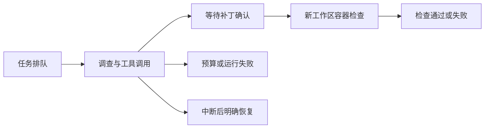

# PatchTrail

受控仓库排错与补丁验证工作台。选择一个失败任务，查看Agent读取代码和调用工具的过程，确认具体补丁，再由不可修改的测试决定检查结果。

[HTTPS公开演示](https://math.madokanun.top:8444) · [源码](https://github.com/oNanachii/patchtrail) · [部署验收](docs/PUBLIC_DEPLOYMENT_2026-10-28.md)。公开模式运行预置脚本，不调用模型；真实DeepSeek模式及其记录需要操作令牌。

项目面向Agent应用、Python后端和全栈交付实践。v0.1先支持三个公开的小型Python回归任务：库存数量缺口、补货覆盖旧批次日期、标签与历史非原子提交。它们根据已观察到的问题独立编写，是已知回归案例，不是盲评、SWE-bench成绩或通用代码修复能力证明。

## 一次完整运行

1. 选择任务和执行方式。脚本演示不调用模型；DeepSeek模式会进行真实API调用。
2. 在受限任务副本中读取文件、搜索代码、复现原始测试失败。
3. 提出单文件补丁，停在等待确认状态。
4. 操作者确认补丁digest及运行版本。
5. 从原始任务重建验证副本，应用准确补丁，在无网络、只读挂载、非root的受限容器中检查。
6. 保存状态、工具事件、diff和实际检查输出；成功状态由程序判定。



## 本地启动

Python 3.12或3.13。先进入本项目目录：

```sh
python3 -m venv .venv
.venv/bin/python -m pip install -r requirements.lock.txt
cp .env.example .env
```

在`.env`设置独立操作令牌及`DEEPSEEK_API_KEY`。配置文件由应用启动时读取，保存后需重启；不要覆盖已有配置。默认模型`deepseek-flash`与调用方式依据[DeepSeek官方工具调用文档](https://api-docs.deepseek.com/guides/tool_calls/)核对，模型可通过环境变量调整。

容器运行时需要Docker或兼容的Podman；预先拉取所选镜像，生产配置使用完整digest。运行请求不自动拉镜像。没有容器时可以查看界面和API，创建执行任务会明确返回503，不会转到宿主机执行。

```sh
.venv/bin/python -m uvicorn patchtrail.api:create_app --factory --host 127.0.0.1 --port 8874 --workers 1 --no-access-log
```

打开`http://127.0.0.1:8874`。首版只支持单API进程和单执行worker，不要添加多个uvicorn workers。状态与工作区默认保存在被Git忽略的`var/`。

## 执行边界

- 公开演示仅使用内置任务与受信脚本补丁；真实模型运行及其记录需要操作令牌。
- 不提供任意仓库上传、任意shell或公网代码提交入口。
- 四个工具：有界读文件、字面搜索、固定检查、补丁提案。文件和工具结果作为数据，不视作用户指令。
- OCI容器禁网、只读根与工作区、非root、移除capabilities、no-new-privileges，并限制CPU、内存、进程、文件、时间和输出。
- 基线需确认实际执行了用例；验证需正数用例、退出码0、未超时/截断且测试输出正常结束。它是有限回归判定，不是对抗性防作弊证明。
- 重启后活动任务标为中断，待确认提案保留；恢复需明确操作。未知模型请求不自动重试，不保证精确一次外部执行。

## 检查

前端采用React、TypeScript与Vite；构建后的`web/`已提交，部署时只需Python及容器运行时。修改前端或执行完整开发检查时，先安装锁定的Node依赖：

```sh
cd frontend
npm ci
npm test
npm run typecheck
npm run build
cd ..
```

```sh
.venv/bin/python -m unittest discover -s tests -v
```

单元与契约检查明确使用假runner/provider，检查状态和协议；fixture开发检查只执行受信自编源代码。实际OCI集成、真实DeepSeek效果、浏览器验收和用户面试讲解分别记录，不能合并成一个“全部通过”。当前结果与待验收项见[项目状态](PROJECT_STATUS.md)。自动CI模板位于`deploy/ci-workflow.yml.example`；启用需要仓库的workflow写入权限，尚未把本地通过当作CI通过。

## 首轮真实模型验收

2026年10月28日使用真实DeepSeek API，在预先选定的3个已知回归任务上各运行一次。模型自行调用工具并提出补丁，经本轮Codex代码审查及确认接口进入新的受限容器；每项原始版本均实际失败，修复后4条用例均通过。

| 已知任务 | 模型调用 | 实际Token | 修复后检查 |
| --- | ---: | ---: | --- |
| 库存数量缺口 | 3 | 5072 | 4条通过 |
| 补货批次到期 | 4 | 7005 | 4条通过 |
| 标签与历史事务 | 3 | 4921 | 4条通过 |

共10轮模型调用、16998 Token；未使用脚本provider生成这些补丁。API返回的模型标识为`deepseek-flash`别名，没有提供不可变权重快照。这是小范围已知任务的真实联通与回归结果，不支持通用修复准确率、未知任务表现或用户面试能力的结论。原始失败与修复、提案digest、源码版本和验证范围见[验收记录](artifacts/live-model-validation.json)。

首个任务的状态查询曾发生数据库锁竞争；核对原运行后继续验证，没有重复创建付费任务。随后增加同一Store实例的数据库操作串行化、可重试的存储忙响应和有界只读重试。跨进程或外部连接竞争仍需SQLite及运维处理，不能据此声称所有锁根因已解释。

## 交付材料

- [架构与取舍](docs/ARCHITECTURE.md)
- [Claude前端设计交接](docs/CLAUDE_FRONTEND_HANDOFF.md)与[可复制的启动提示](docs/CLAUDE_FRONTEND_PROMPT.txt)
- [面试讲解与独立验收](docs/INTERVIEW_WALKTHROUGH.md)
- [服务器部署与回退](deploy/README.md)
- [公网前端与HTTPS验收](docs/PUBLIC_DEPLOYMENT_2026-10-28.md)
- OpenAPI契约：启动后的`/api/openapi.json`

前端由用户自行在Claude Code中完成设计，再经Codex独立检查和修正。已核对真实后端、补丁确认、容器检查、报告下载及桌面/移动宽度布局；未完成实体手机、屏幕阅读器或用户面试讲解验收。项目使用AI辅助开发，代码实现、用户关键判断及用户独立能力分别说明。

## 参考与许可

实现参考了[mini-swe-agent](https://github.com/SWE-agent/mini-swe-agent)的简洁控制流、[OpenHands Software Agent SDK](https://github.com/OpenHands/software-agent-sdk)的工作区与事件分离、[Inspect AI](https://github.com/UKGovernmentBEIS/inspect_ai)的任务/评分/日志分层。没有导入这些框架或沿用它们的成绩。源码归属与参考边界见[第三方说明](THIRD_PARTY_NOTICES.md)。本项目使用MIT许可。
