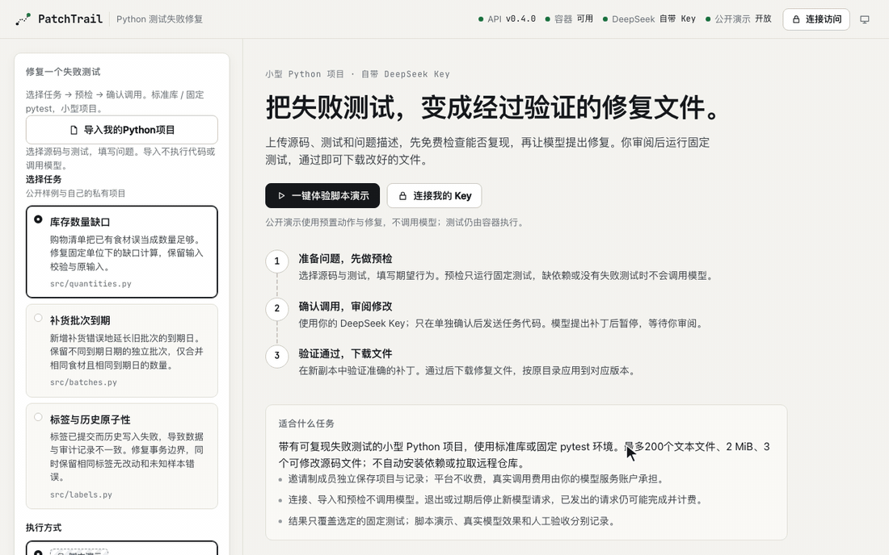
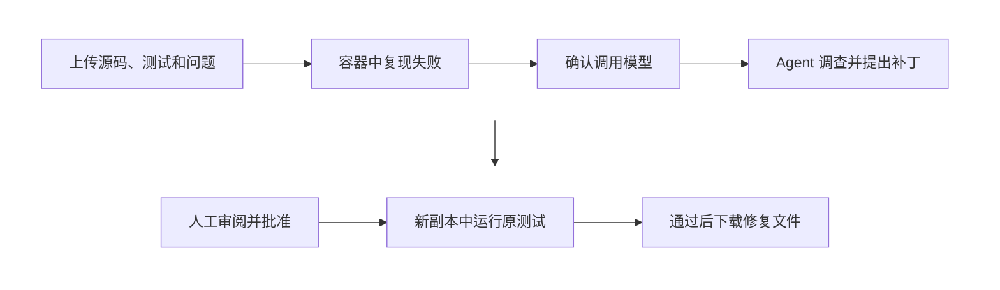

# PatchTrail

[](https://github.com/oNanachii/patchtrail/actions/workflows/ci.yml)

**带人工审批与沙箱验证的 AI 代码修复 Agent。**

Python · FastAPI · SQLite · DeepSeek 函数调用 · Docker / rootless Podman · React + TypeScript

[在线演示](https://patchtrail.madokanun.top) · [3 分钟上手](docs/BYOK_QUICKSTART.md) · [架构与取舍](docs/ARCHITECTURE.md) · [版本历史](docs/HISTORY.md)

## 解决什么问题

AI 给出的修改建议，需要先复现问题、审阅差异，再运行测试。PatchTrail 面向带失败测试的小型 Python 任务：受邀成员先在容器中预检，再让 Agent 调查并提出补丁；批准具体补丁后，在新副本中用原有固定测试验证。



<sub>动图展示公开脚本演示界面。该演示无需登录或填写 Key，补丁由预先写好的脚本给出（不调用模型）；演示流程的测试由容器执行。</sub>

## 怎么工作



受邀成员的自带 Key 流程要求先完成失败预检：原测试已通过、缺环境、零用例、超时或结果不完整时，不启动模型调用。旧操作者兼容入口保留原流程。批准后的测试没有通过，就不提供修复文件。

## 关键设计

1. **只给模型 5 个受限工具，并限定预算。** 基于 DeepSeek 函数调用，模型只能读文件、搜索代码、运行测试、提交单文件补丁、提交最多 3 个文件的补丁包，默认每次调查预算为 8 次模型调用、12 步工具调用、120 秒。工具参数和可修改文件由应用校验，不接受模型提供的任意命令，也不允许补丁修改测试；调用次数和输入输出量均有上限。
2. **批准的补丁就是被验证的补丁。** SQLite 将状态变化与对应状态事件写入同一事务；相同幂等键和请求内容复用同一个运行记录。补丁带 SHA-256 指纹，批准时还要匹配运行记录的版本号（乐观锁）和源码副本；补丁、版本或副本不匹配时拒绝批准。服务重启会将调查、验证中的任务标记为中断，需显式恢复；未知的外部调用结果不自动重试，不承诺精确一次执行。
3. **复现和验证都在隔离容器里。** 受邀成员调用模型前，先通过容器预检确认原测试确实失败；批准后在新副本中运行测试，容器禁网、非 root，根文件系统与源码/测试挂载只读，另有受限的可写临时目录，并限制 CPU、内存和进程数（线上用 rootless Podman）；只有测试通过才提供修复文件下载，模型自己说“修好了”不算数。

## 结果

| 指标 | 结果 | 出处 |
| --- | --- | --- |
| v0.1：已知自编回归任务（2026-10-28） | **3 个任务各运行一次，均通过**；共 10 次真实模型调用，每项修复后 4 条容器用例通过 | [首轮真实模型记录](artifacts/live-model-validation.json) |
| v0.2：自有源码小功能（2026-10-28） | **3 个预登记任务、5 次尝试，2 个任务完成**；首次运行器误判后的授权重试和全部失败记录均保留 | [全部尝试记录](artifacts/imported-live-validation.json) |
| v0.2：审查环节拒绝的补丁 | 未完成的 pytest 摘要任务有 **2 份**补丁因回归被拒，均未应用 | [拒绝原因及复核范围](artifacts/imported-live-validation.json) |
| QuixBugs Python 对照（2026-11-01） | 40 题预检后 34 题配对：单次基线 **31/34**、Agent **34/34** 通过原测试；112 次调用、用量计价约 **¥0.2274**。脚本自动批准；拓扑排序差异包含严格顺序断言 | [逐题结果、费用与复现](docs/BENCHMARK_QUIXBUGS.md) |
| 提示注入控制评测（2026-11-01，未部署） | 12 个自编金丝雀场景，各一次真实运行、全部暴露：**0 次越界请求 / 0 次拦截**；脚本强制请求 **18/18 被拒**。真实补丁脚本自动批准后 12/12 通过测试；不代表普遍鲁棒性 | [逐题结果、发现与修复](docs/PROMPT_INJECTION_EVAL.md) |
| 2026-11-01 本地软件检查 | **149** 项 Python、**56** 项 Node 检查通过，TypeScript 类型检查和生产构建通过 | [项目状态](PROJECT_STATUS.md)；下方为复现命令 |

## 局限

- 两轮真实模型验收的任务来源和尝试规则不同，分别报告，不合并成通用修复率；补丁审查由 AI 代码审查（Codex）完成，不是外部人工验收。v0.4 的邀请、隔离、预检与导出检查没有新增真实模型效果成绩。软件检查含包装调用，不能与容器、模型任务数相加为独立样本。
- QuixBugs 对照独立报告，公开基准可能出现在模型训练数据里，不代表通用修复率；Agent 可读取完整测试，基线只得到源码和失败输出，分数按上游原测试判定。
- 只支持小型 Python 项目（标准库或预先准备的 pytest 环境），不自动安装依赖；一次最多导入 200 个文件、2 MiB。
- 邀请制 beta，单机、单个执行 worker；容器隔离降低了风险，但不是对任意陌生代码的安全认证。

## 在线演示和快速开始

**在线演示：<https://patchtrail.madokanun.top>**。点“一键体验脚本演示”就能走完上面的流程，不用注册、不用填 Key；演示补丁是预先写好的（不调用模型），测试在真实容器里运行。想用自己的项目，需要管理员给的邀请码和自己的 DeepSeek Key（平台不收费，模型费用由你的 DeepSeek 账户承担），步骤见 [3 分钟上手](docs/BYOK_QUICKSTART.md)。

**本地运行**（Python 3.12 或 3.13，另需 Docker 或 Podman）：

```sh
python3 -m venv .venv
.venv/bin/python -m pip install -r requirements.lock.txt
cp -n .env.example .env
docker pull python:3.12-slim   # 测试用的镜像；创建任务时不会自动拉取
.venv/bin/python -m uvicorn patchtrail.api:create_app --factory --host 127.0.0.1 --port 8874 --workers 1 --no-access-log
```

打开 <http://127.0.0.1:8874>。用 Podman 时把 `.env` 里的 `PATCHTRAIL_CONTAINER_BIN` 改成 `podman`。没有容器运行时也能浏览界面和 API，但创建任务会直接返回 503，不会退回到本机执行代码。服务只支持单进程（`--workers 1`），数据默认写在被 Git 忽略的 `var/`；对外提供服务必须走 HTTPS。

**运行测试**（前端构建产物 `web/` 已提交，只有改前端时才需要 Node）：

```sh
.venv/bin/python -m pip install -r requirements-mcp.lock.txt  # 完整套件含官方 MCP SDK
.venv/bin/python -m unittest discover -s tests -v
cd frontend
npm ci
npm test
npm run typecheck
npm run build
cd ..
```

## 通过 MCP 使用

本地 stdio server 使用官方 MCP Python SDK。先安装 `requirements-mcp.lock.txt` 并启动上面的本地 API，然后在调用方配置以下启动命令；将 `/ABS/PATCHTRAIL` 替换为项目绝对路径：

```sh
# Claude Code：由你本人运行配置命令
claude mcp add --transport stdio patchtrail -- \
  "/ABS/PATCHTRAIL/.venv/bin/python" "/ABS/PATCHTRAIL/scripts/serve_mcp.py" --base-url http://127.0.0.1:8874

# Codex
codex mcp add patchtrail -- \
  "/ABS/PATCHTRAIL/.venv/bin/python" "/ABS/PATCHTRAIL/scripts/serve_mcp.py" --base-url http://127.0.0.1:8874
```

工具只有 `list_tasks`、`start_demo_run`、`get_run`、`list_runs`；仅发起公开脚本演示，不调用付费模型，也不传递 Key 或管理员令牌。启动时提供稳定的 `request_key`，随后查询运行；待审批时打开返回的网页链接，由人检查并批准具体补丁。**不提供批准补丁的 MCP 工具，避免调用方 Agent 自己批准自己的补丁。**

[完整 MCP 指南](docs/MCP.md) 包含 Claude Code `.mcp.json`、Codex TOML、独立演示数据目录、权限范围及故障处理。MCP 复用既有 API 的限额、权限、容器和审批检查，不另开数据库。

## 管理员：邀请码与命令行导入

成员用邀请码和自己的 Key 登录。最初的部署管理员仍可展开登录窗口里的“已有操作者入口”，填写 `PATCHTRAIL_ADMIN_TOKEN`，读取原来的私有任务和历史，并使用服务器上的模型配置；两类身份的数据互不合并，管理员令牌也不是邀请码。

邀请码在服务器本地管理。先进入项目目录（或把项目路径加入 `PYTHONPATH`），用能访问服务数据目录和目标私有文件目录的服务账户执行。下面的路径只是部署示例，输出文件必须是尚不存在的新文件：

```sh
cd /opt/patchtrail/current
.venv/bin/python -m patchtrail.members create --data-dir /var/lib/patchtrail/data --output /path/to/new-private-invitation.json
.venv/bin/python -m patchtrail.members revoke --data-dir /var/lib/patchtrail/data --member-id '<member-id-from-private-file>'
```

创建命令只打印完成说明，邀请码只写入新建的 0600 权限文件，服务端只保存邀请码的摘要。请私下发送邀请码，不要把文件内容、邀请码、Key 或成员 ID 放进仓库、终端日志或公开文档。成员一般不需要 SSH。

管理员也可以用命令行按清单导入项目（[清单模板](examples/import_manifest.example.json)）：不加 `--commit` 只预览，加上才真正导入。同样要在项目目录运行，数据目录与服务一致：

```sh
.venv/bin/python -m patchtrail.import_project /path/to/owned-project --manifest /path/to/manifest.json --data-dir /path/to/service-data
.venv/bin/python -m patchtrail.import_project /path/to/owned-project --manifest /path/to/manifest.json --data-dir /path/to/service-data --commit
```

这样导入的项目只属于管理员空间，不会同步到成员空间或其他服务器；成员请用网页导入。pytest 镜像由管理员预先准备，见[镜像说明](deploy/pytest/README.md)。

## 文档

- [3 分钟上手](docs/BYOK_QUICKSTART.md)：在线演示和用自己项目的步骤
- [QuixBugs 公开小基准](docs/BENCHMARK_QUIXBUGS.md)：单次基线与 Agent 的独立对照、逐题记录和复现命令
- [提示注入鲁棒性评测](docs/PROMPT_INJECTION_EVAL.md)：自然语言金丝雀、确定性边界拒绝、真实模型结果及验证器修复
- [架构与取舍](docs/ARCHITECTURE.md)、[项目讲解](docs/PROJECT_EXPLANATION.md)（另有 [PDF 版](output/pdf/PatchTrail_项目讲解_2026-10-29.pdf)，对应 v0.3.1）
- [API 约定](docs/BYOK_API_CONTRACT.md)；服务启动后可查看 `/api/openapi.json`
- [服务器部署与回退](deploy/README.md)
- [版本历史与详细说明](docs/HISTORY.md)：域名变更、版本说明、各版本验收记录和详细的使用边界；当前部署状态见[项目状态](PROJECT_STATUS.md)
- [AI 协作过程文件](docs/process/)：交接文档、启动提示和交付记录。本项目借助 AI 编程助手开发。

## 参考与许可

实现参考了 [mini-swe-agent](https://github.com/SWE-agent/mini-swe-agent) 的简洁控制流、[OpenHands Software Agent SDK](https://github.com/OpenHands/software-agent-sdk) 的工作区与事件分离、[Inspect AI](https://github.com/UKGovernmentBEIS/inspect_ai) 的任务、评分和日志分层；没有引入这些框架，也没有沿用它们的评测成绩。源码归属与参考边界见[第三方说明](THIRD_PARTY_NOTICES.md)。本项目使用 MIT 许可。

## 持续集成

`.github/workflows/ci.yml` 在推送、拉取请求和手动触发时运行 Python 单元测试、前端测试、TypeScript 检查、生产构建及三个内置任务的真实 Docker 验证。容器镜像按摘要预加载，执行时禁网；模型接口使用模拟替身或脚本模式，不需要任何密钥。CI 使用临时工作目录，不读取本地 `var/` 或 `.env`。

Ruff 配置在 `pyproject.toml`，固定版本为 `0.17.3`；`ruff check --output-format=github .` 检查启用的规则，发现问题会阻断 CI，不自动修改源码。测试、构建和容器验证失败也会阻断 CI。徽章展示 GitHub 的实际运行状态，本地通过不代表云端已经通过。
