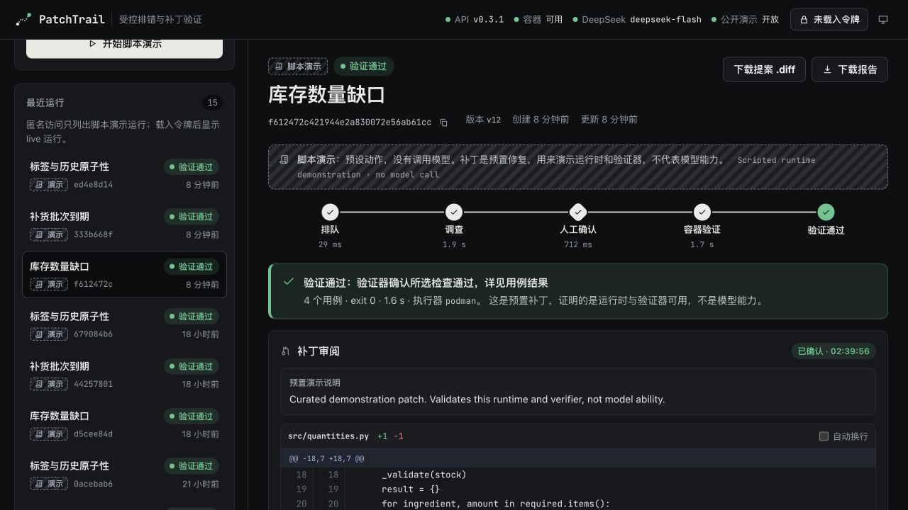

# PatchTrail 项目讲解

从实际使用到面试表达 · v0.3.1 · 2026年10月29日

## 01 它解决什么问题

**一句话：把一个带测试的Python修改任务，变成“调查、提案、确认、验证、留证”的完整过程。**

只把代码粘贴进聊天窗口，通常能得到修改建议，但还要自己判断：模型看了哪些文件？原问题是否复现？它有没有改掉测试？运行出错后该重试哪一步？PatchTrail把这些事情放进同一条可检查的流程。

<!-- diagram:workflow -->

### 一个与现有项目有关的实际案例

文本分类工作台需要修改样本标签。假设页面A和页面B同时打开版本0的样本：A先保存，记录变为版本1；B仍用旧页面保存时，应当拒绝，避免覆盖新修改。任务是在现有源码快照中增加可选的 `expected_revision`，同时保留旧调用方式和历史记录。

这项小功能已有真实DeepSeek提案、内部代码审查、5条Podman用例及导出后独立复验记录。它说明受控流程曾在既有仓库源码上完成任务；补丁并没有因此自动合入文本分类项目的主分支。

### 你最终拿到什么

- 一份固定版本的任务源码与测试，以及模型调查和工具调用记录。
- 一份待审阅的修改建议，可查看差异或下载 `.diff`。
- 确认后，新副本中实际运行测试的结果，以及可下载的JSON报告。

**当前定位：单操作者、小型Python排错与功能补全工作台。** 它使用现成模型API，项目重点在后端编排、状态一致性、审批、执行边界和证据记录；没有训练自己的大模型。

建议阅读顺序：先按第2页体验，再按第3页使用自己的代码；第4至6页理解实现，第7至8页准备讲解与动手验收。

<!-- page -->

## 02 先用公开演示跑通一次

打开 [在线项目](https://math.madokanun.top:8444)。首次体验不需要操作令牌，也不需要DeepSeek Key。

1. 选择“库存数量缺口”，保留“脚本演示”，点击“开始脚本演示”。
2. 查看调查记录：原测试确实失败，系统读文件并形成补丁，随后停在待确认状态。
3. 阅读修改差异，再点“确认并验证”。程序会从原快照新建副本并运行容器测试。
4. 查看结果中的运行器、测试数、退出码、是否超时，以及差异和报告。

### 看懂这三个信号

- **待确认**：已经有修改建议，尚未应用到验证副本。
- **验证通过**：这份补丁在新副本中通过了所选固定测试；并不证明所有输入都正确。
- **演示 / LIVE**：脚本演示使用预置动作和补丁，不调用模型；只有LIVE模式才使用DeepSeek API。

本轮三个公开案例重新完成实际容器复现与验证，每个修复后4条用例通过。它们检查系统流程，不记为新的模型修复成绩。

<!-- page -->

## 03 导入自己的代码，再使用DeepSeek

### 先分清两种凭据

**操作令牌 `PATCHTRAIL_ADMIN_TOKEN`** 用于网页私有操作，从本项目私有 `.env` 中复制等号后的值，填到右上角。它只保存在本页内存，刷新后需要重新载入。

**模型Key `DEEPSEEK_API_KEY`** 由后端保管。当前服务器已经配置，网页不用再填。两者不能混用，文档与截图均不包含它们的实际值。

### 按这个顺序操作

1. 载入操作令牌，点击“导入Python项目”。先用一个很小、带失败测试的问题练习。
2. 选择源码和测试文件；项目名称与测试入口会自动识别。填写“现在错在哪里、期望是什么”，检查允许修改的源码，最多3个，测试保持只读。
3. 点击“上传并预览”，核对清单，再“确认导入”。此时只是保存服务器上的私有源码快照，不执行代码、不调用模型。
4. 新任务会自动选中。选择“DeepSeek真实调用”，点击开始，并在费用窗口确认。此后任务代码、测试和工具结果才会进入模型调用流程。
5. 模型提出补丁后会暂停。先审阅差异；确认后才进入新副本容器验证。不接受的建议可以取消。
6. 核对结果，再下载差异和报告。下载补丁不代表验证通过；项目不会自动改本机原仓库、合并PR或部署修复。

### 文件与环境要求

当前最多200个文件、总计2MiB、每文件128KiB；项目内文件路径使用ASCII命名，如 `src/calculator.py`，项目标题可以写中文。文件夹方式保留相对目录，多文件方式按文件名平铺。浏览器会排除重名或不合法文件并列出原因，服务器会拒绝不合规清单。

当前环境提供Python标准库和已配置的pytest，不会自动安装项目依赖；不支持ZIP上传或Git URL拉取。常见秘密文件按名称排除，**这不等于扫描所有硬编码密钥**，上传前仍要检查所选内容。

需要练习时，可选择仓库的 `examples/web-import-quickstart` 文件夹。它只有加法源码和三个只读测试，是明确自编的教学问题；不代表真实业务或未知任务成绩。

<!-- page -->

## 04 模型、后端和容器各做什么

<!-- diagram:architecture -->

### Agent在这里是什么意思

一次普通回答通常是“输入问题，生成文本”。这里的Agent循环会把问题和当前信息交给模型，模型请求某个工具，后端检查参数并执行，再把工具结果交回模型，直到形成提案或遇到停止条件。

**DeepSeek负责判断下一步；后端掌握允许执行的动作。** 模型拿不到任意shell，也不能直接把任务标为成功。当前提供五种工具：

| 工具 | 作用 | 约束 |
| --- | --- | --- |
| read_file | 阅读文件片段 | 路径和读取量受限 |
| search_code | 搜索代码文字 | 字面搜索，结果受限 |
| run_check | 运行固定测试 | 只能选择注册的检查 |
| propose_patch | 提出单文件改动 | 只能改白名单源码 |
| propose_patch_bundle | 提出整包改动 | 最多3文件，一起确认 |

每次工具调用有自己的 `tool_call_id`，返回结果必须与它配对。提案会使诊断循环停下，等待操作者确认。

默认诊断预算为最多8次模型调用、12次工具动作及120秒，另有输入和输出大小限制。这是诊断循环的预算，**不包括人工等待，也不是整个流程120秒完成的承诺**。

服务端凭据与模型通信在后端；浏览器负责表单、事件展示、审阅和明确操作。实际代码执行交给Docker/Podman容器，测试结果由程序解析判定。

<!-- page -->

## 05 为什么不能只是“让模型改一下”

### 先固定现场，再复现失败

导入会保存不可变源码快照，后续任务对应明确的文件版本。模型提出补丁前，程序要确认原版实际执行了测试且确实失败。零测试、环境缺失、超时、输出不完整和原测试已通过，都不能冒充一次成功修复。

### 确认绑定具体补丁与具体版本

`digest` 可以理解成改动内容的指纹；`version` 是运行记录的版本号。确认时两者都要匹配，验证前还要检查源码和工作区指纹。旧页面不能同意一份后来变化的内容。

确认后，系统从原始快照重新建副本，再应用准确的补丁。测试文件不在可修改集合中，避免把“降低测试要求”当作修复。

### 重复点击为什么不会新建另一份运行

创建请求带一个幂等键，相当于同一次操作的领取凭证。后端若已提交、响应却丢失，再用相同键和内容请求，会核对原运行；不同内容重复使用同一键会冲突。这不能保证未知外部模型请求在任何故障下绝对只执行一次。

### 状态和事件一起保存

<!-- diagram:states -->

状态变化与对应事件在SQLite事务中提交；事务可以理解成“这组数据库修改一起成功或一起撤销”。进程重启后，正在调查或验证的任务标记为中断，恢复是明确操作，未知模型请求不自动重试。

容器禁网、限制权限与资源；运行器不可用时停止，不改到宿主机执行。容器约束与固定测试是具体边界，不等于任意恶意代码的绝对安全保证。

<!-- page -->

## 06 检查了什么，还不能说明什么

### 2026年10月29日本轮复查

完整126项Python检查、34项Node检查、TypeScript及生产构建通过。Python包装会调用同一批前端检查，不能相加声称160项独立用例。12份构建文件前后字节一致。

三个公开脚本案例重新经过实际HTTP、人工确认接口与Podman测试流程，均成功。独立检查覆盖导入前置鉴权、重复提交同任务、路径与只读测试限制、私有访问、令牌切换，以及准确补丁确认；未发现阻断问题。

本轮复查未发起DeepSeek付费调用。网页上传与真实模型效果分别判断；此前已有的模型记录保持其原始范围。

另只读核对到一条在本轮复查前创建的较新真实运行：验证通过，5条Podman用例通过。它没有被本轮重新发起，和下面原v0.2预登记统计分开记录。

### 历史真实模型结果，应该怎样读

v0.2在两个仓库来源的3个预登记小功能上共尝试5次，发生20次模型调用、共88253 Token。两个任务完成审查、5条用例及导出后独立复验，都来自文本分类仓库。

pytest摘要任务的两份补丁因回归被审查拒绝，均未应用。另外，一次合法unittest子测试被运行器误判的失败和修正后的授权重试也保留。**不能把这组有限、已知任务写成通用修复成功率。**

更早v0.1的3个已知自编案例有10轮真实调用和修复后12条容器用例，它们是另一组历史记录。当前运行器支持pytest并有实际容器验收；模型未完成pytest摘要任务，不等于系统没有pytest支持。

### 这个项目目前的边界

- 单操作者、单Agent、单服务worker；没有实现成熟多租户平台或分布式队列。
- 不自动安装任意依赖、处理任意仓库，也不自动合并补丁。
- 测试通过只覆盖所选检查；没有未知任务、性能提升或SWE-bench成绩。
- 本轮模拟视口与代码检查，不能替代实体设备、长期负载和本人独立能力验收。

一次真实取舍：模型仍在运行时，客户端曾遭遇SQLite锁错误。没有因此重建付费任务，而是核对原运行。后续增加存储忙503、有界读取重试和单Store实例串行化；这不等于已解决所有跨进程竞争。

<!-- page -->

## 07 面试时可以怎样讲

### 一分钟项目介绍示例

> PatchTrail是一个AI协作开发的受控Python排错与补丁验证工作台。它把任务源码固定成快照，通过FastAPI和SQLite保存运行状态与事件。模型只能使用受限工具调查问题和提出补丁，操作者确认具体内容与版本后，程序从原快照建立新副本，在受限容器里运行不可修改的测试。项目还处理了重复请求、过期确认、私有数据清理和失败记录，已部署并开源。真实模型只在有限任务上做过验收，没有宣称通用修复准确率。

这段只描述已实现的系统。你个人负责过哪些判断、能独立解释或修改哪些代码，应在实际动手后再补充，不能把AI完成自动讲成本人独立完成。

### 三分钟展示顺序

1. 30秒：用“旧页面覆盖标签”的案例说明问题与完成条件。
2. 60秒：展示任务、原始失败、修改差异、等待确认和实际测试结果。
3. 60秒：挑两项关键设计讲原因，例如幂等重试和确认指纹，指出对应代码。
4. 30秒：讲一次失败或拒绝案例，再说明目前的运行边界。

### 常见追问与回答要点

**为什么用SQLite？** 当前是单机、单worker、单操作者，先把事务、版本和恢复做好；没有实际容量数据，不说性能胜过其他数据库。

**为什么需要人工确认？** 模型提案可能回归；确认精确内容后再验证，避免把解释文字当成正确性。

**与编码助手有什么区别？** 这是一个范围较小、可核对的任务执行工作台，重点展示任务版本、审批、固定测试和状态恢复；不宣称成熟编码助手都没有这些能力。

**为什么不是多Agent / RAG？** 当前任务依赖选定源码与固定检查，单Agent已经能覆盖流程；没有需求和对照结果，不为技术名词增加复杂度。

**你训练了模型吗？** 没有。这里调用现成DeepSeek API；另一个文本分类项目的小型模型训练是不同项目，不能混在一起描述。

<!-- page -->

## 08 从会读文档，到能自己讲清楚

### 按顺序完成五个小练习

1. 不看讲解，说明“演示、导入、真实调用、确认补丁”四个动作的区别，指出哪一步会发送代码给模型。
2. 找到一条完整运行，说清原版为什么失败、补丁改了什么、哪些测试实际通过，以及原项目有没有被自动修改。
3. 在本地隔离测试环境，解释同一幂等键的重复创建为什么返回同一运行，再解释为什么不能保证外部请求绝对只发生一次。
4. 找出确认所需的digest和version，解释旧版本确认为什么会冲突；不要对仍在使用的真实任务随意做破坏试验。
5. 沿源码指出：模型请求工具、参数校验、保存事件、形成提案、确认后新建验证副本的位置。本人验收另行记录，不因读完此文自动算通过。

### 源码阅读地图

| 想理解什么 | 先读哪个文件 |
| --- | --- |
| 导入与操作权限 | patchtrail/api.py、web_imports.py |
| 源码快照与路径规则 | patchtrail/projects.py |
| 模型协议与五个工具 | patchtrail/providers.py |
| Agent循环与确认验证 | patchtrail/service.py |
| 事务、幂等键、状态和事件 | patchtrail/storage.py |
| 指纹、差异与整包应用 | patchtrail/workspace.py |
| 测试结果及容器约束 | patchtrail/sandbox.py、check_profiles.py |
| 页面操作与凭据代次 | frontend/src/App.tsx、lib/authEpoch.js |

### 复核依据与进一步阅读

[源码仓库](https://github.com/oNanachii/patchtrail) · [在线项目](https://math.madokanun.top:8444)

[本轮复查摘要](../artifacts/recheck-2026-10-29.json) · [网页导入交付](WEB_IMPORT_DELIVERY_2026-10-29.md) · [模型与容器历史验收](V0_2_DELIVERY_2026-10-28.md) · [真实调用汇总](../artifacts/imported-live-validation.json) · [架构说明](ARCHITECTURE.md)

这份讲解依据已实现代码与有限验收整理，帮助建立理解和展示顺序。项目工程完成、真实模型效果、你本人的掌握程度，分别判断。原投递简历和已有学习通过记录保持不变。
