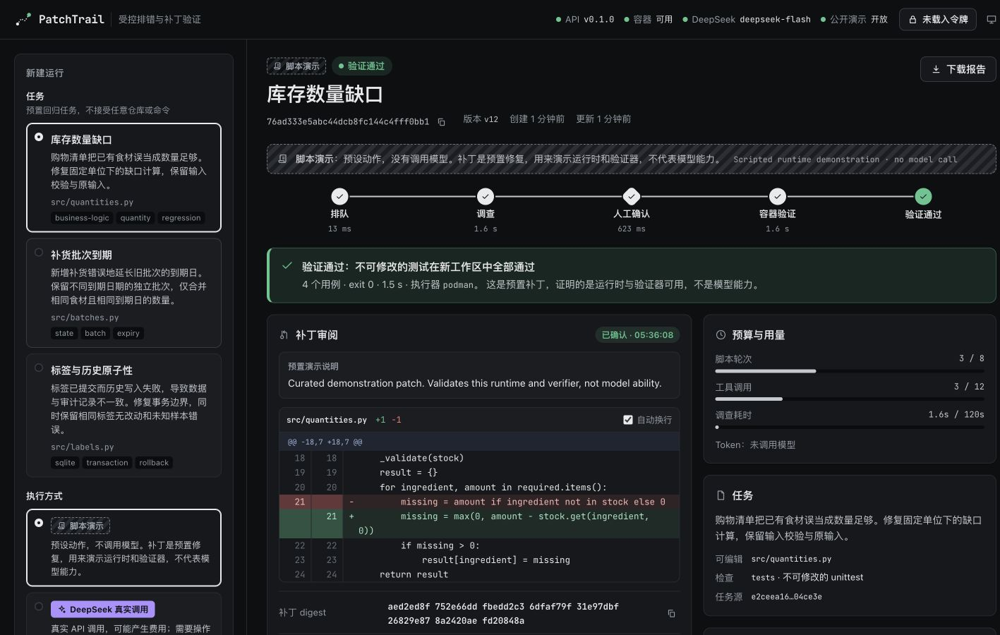
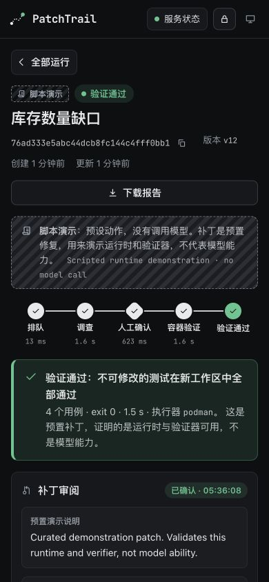

# 公网前端与HTTPS验收

2026-10-28，运行代码提交`54ac264`部署为`20261028-frontend-01`。入口为[PatchTrail HTTPS演示](https://math.madokanun.top:8444)，[源码](https://github.com/oNanachii/patchtrail)。后续文档和验收工件提交不改变该运行代码。

## 前端独立复核

用户在Claude Code中交付React/TypeScript前端；Codex复核后修正了三个行为边界：令牌切换立即清除受保护缓存并丢弃旧请求结果；创建请求结果未知时，重试被限流等前置条件拒绝仍保留原幂等键；零测试、OCI异常、超时或输出不完整时明确标记验证未确认，不归因为补丁失败。

最终本地77项Python检查、21项Node逻辑/SSR检查、TypeScript检查和生产构建通过。部分Python检查调用Node检查，不能把两组数量直接视为98个独立用例；自动GitHub CI未启用。

独立浏览器使用实际服务器和rootless Podman，完成脚本任务新建、diff审阅、精确确认、容器验证和实际JSON报告下载。也读取既有真实DeepSeek记录，核对模型标识、用量及检查结果，清除令牌后私有详情立即遮蔽。创建与鉴权的受控竞态另由逻辑回归验证，未声称通过浏览器网络拦截重现。

[前端复核记录](../artifacts/frontend-independent-review.json)保留完整范围。Claude原交付声称的11个headless Chrome场景未全部独立重跑，不能与本轮结果混同。

## 公网实际检查

- 正常DNS及系统信任完成TLS验证，未使用证书绕过。全部11个前端文件按实际`/assets/`挂载逐字节匹配，包括JS、CSS、本地字体和第三方许可文本；CSP、noindex、API no-store及新增入口不发送HSTS均核对。
- 匿名live创建被401拒绝；既有live详情、事件和报告也为401，匿名列表只含demo。原3个live记录仍可经操作令牌读取。
- 3个公开脚本任务依次新建并确认，均由真实Podman检查通过，各4条用例。重复创建和重复确认沿用原请求/提案，没有新增模型调用。这验证脚本运行时及容器，不是新增模型能力测试。
- 公网浏览器在1440×900和390×844读取实际完成结果，页面横向溢出为0；采集的JS/CSP告警及错误为空。浏览器显示脚本标记、真实podman结果及4条用例；截图见下方。

[公网TLS/资源/权限记录](../artifacts/public-https-validation.json)，[实际HTTP/OCI流程报告](../artifacts/public-https-workflow.json)。首次通用文件探针错误请求根路径的许可文件，404后按真实`/assets/`挂载复核通过，无需修改应用。代理初启时后端刚重启，首次本机探针短暂502；重试和后续公网请求通过，记录未将其隐藏为从未出错。

## 部署边界与回退

应用仍绑定`127.0.0.1:3110`，使用外部私有环境与持久数据。新Caddy v2.11.7使用独立路径、配置、状态目录及unit，只新增8444/TCP。原Xray、数学服务及原数学代理的PID、启动时间和状态与启用前基线完全一致；原22/80/443/3100/3110/8443 TCP监听仍在，新增8444。仅增加UFW8444允许规则，未改变DNS或原代理配置。

新代理复用既有受管证书路径，未复制私钥或放宽权限。代理和证书文件watcher已启用开机运行；手动触发仅新代理的reload，PID保持，日志确认SIGUSR1重载成功，TLS继续正常。未触发未来真实ACME续期，手动reload不代表续期事件已验收。

准备阶段曾在同一脚本内比较旧Caddy及证书/key元数据相同，但未保存这些旧值；启用阶段只保存了当前值，无法再次逐值比较。因此不声称启用前后这些文件已有完整哈希/元数据对照。动态Fail2ban规则也未作全量逐字节一致断言；可直接复核的是原服务身份、监听与新端口规则。

代码回退可将`current`切回保留的backend-03并只重启PatchTrail；数据与密钥在release外。仅回退HTTPS时，停止新proxy与watcher并删除本次新增的精确8444规则，不动旧服务。参见[独立HTTPS操作说明](../deploy/https/README.md)。

## 尚未验收

没有实体触控设备、Safari/Firefox、屏幕阅读器、长时间运行或用户视觉验收；本人面试解释及独立修改尚未验收。现有3个已知任务的DeepSeek结果来自此前后端版本，保留原运行来源，不将它们冒充本次新部署后的新模型测试。
